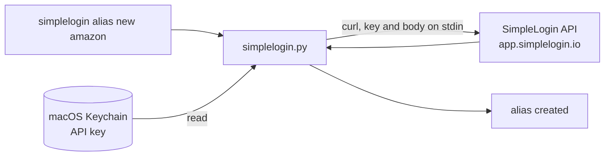

<div align="center">

[](README.md)


# simplelogin-cli

**Run your SimpleLogin account from the terminal.**<br>
Aliases, mailboxes, custom domains and settings behind one `simplelogin` command. Python and `curl`, no dependency, your API key stays in the macOS Keychain.

[](LICENSE)
[](#requirements)
[](simplelogin.py)
[](https://curl.se)
[](https://simplelogin.io)

</div>

<p align="center"></p>

## Why

One alias per website, switched off when it turns into spam, a catch-all on a domain: SimpleLogin's web interface does it all, but it is still clicks. `simplelogin` puts it in a command you can run by hand, from a script or from an AI agent, with guard rails: nothing irreversible without `--yes-destructive`.

The API reference is [docs/api.md](https://github.com/simple-login/app/blob/master/docs/api.md) in the SimpleLogin repository.

## How it works



- **Key kept out of arguments.** The API key lives in the macOS Keychain (service `simplelogin-cli.api`). It goes to `curl` over stdin, never as an argument or in the output, so it does not show in the process list.
- **Reversible runs now, destructive needs confirmation.** Creating, editing, enabling or disabling an alias runs right away. Deleting an alias or a mailbox requires `--yes-destructive`. To stop an alias, `alias disable` is enough.
- **Aliases by address or id.** Wherever a command expects an alias, give the full address or the numeric id.

## Install

```sh
curl -fsSL https://raw.githubusercontent.com/pyxl-dev/simplelogin-cli/main/install.sh | sh
```

The installer puts the code in `~/.local/share/simplelogin-cli` and links `simplelogin` into `~/.local/bin`. Run it again to update; `--uninstall` removes it (the config and the Keychain item stay, it tells you how to delete them). It only touches your home folder.

Then:

1. In SimpleLogin: Settings, then API Keys. Create a key.
2. `simplelogin configure`, then paste the key in the hidden prompt. The default URL is `https://app.simplelogin.io`; change it if you use a self-hosted instance.
3. `simplelogin whoami` checks access.

### Let your AI agent do it

Paste this into Claude Code, Codex, Cursor or any agent with a shell:

```text
Install and use simplelogin-cli: https://github.com/pyxl-dev/simplelogin-cli
Follow the AGENTS.md in that repository.
```

[`AGENTS.md`](AGENTS.md) tells the agent how to install it, how to use it and the safety rules (never ask for the API key in chat, no deletion without your agreement).

### Requirements

| | Needed for |
| --- | --- |
| macOS | storing the API key in the Keychain (`security` command) |
| Python 3.9 or newer | running the script (the one shipped with macOS works) |
| `curl` | talking to the API (ships with macOS) |
| A [SimpleLogin](https://simplelogin.io) account and an API key | everything else |
| [o2switch-cli](https://github.com/pyxl-dev/o2switch-cli), optional | applying the DNS records with the commands `domain dns` prints |

## Usage

```sh
simplelogin alias list
simplelogin alias list netflix
simplelogin alias new amazon --domain sl.example.com --note "Amazon"
simplelogin alias random --note "forum"
simplelogin alias disable amazon@sl.example.com
simplelogin alias edit amazon@sl.example.com --note "Amazon FR" --pin
simplelogin alias activity amazon@sl.example.com
simplelogin alias reply amazon@sl.example.com contact@example.org   # address to write from the alias
simplelogin alias delete amazon@sl.example.com --yes-destructive

simplelogin mailbox list
simplelogin mailbox add me@example.com

simplelogin domain list
simplelogin domain set sl.example.com --catch-all on
simplelogin domain dns sl.example.com --verification "sl-verification=..."

simplelogin setting show
simplelogin export > alias.csv
```

`simplelogin --help` and `simplelogin <command> --help` list every option. Besides the examples above: `alias show`, `alias contacts`, `alias list --enabled|--disabled|--pinned|--json`, `mailbox default`, `mailbox delete`, `domain trash`, `setting set key=value`.

Deleting a mailbox without `--transfer-to` also deletes its aliases: the error message says so before requiring `--yes-destructive`.

### Custom domain

The API cannot add a domain: do it once in the web interface, which shows the `sl-verification` code. Then `simplelogin domain dns <domain>` prints the records to create (MX, SPF, DKIM, DMARC, verification). By default they come out as `o2switch dns set` commands (see [o2switch-cli](https://github.com/pyxl-dev/o2switch-cli)). For another DNS host, `--format table` gives a name, type, value table separated by tabs; to make it the default, set `SIMPLELOGIN_DNS_FORMAT=table`.

The command writes nothing to DNS, it only prints. For a root domain already used by another mail provider, merge the MX and SPF by hand.

## Security

- The API key is never written to a file or to a process's arguments: macOS Keychain, then `curl`'s stdin.
- The config (`~/Library/Application Support/simplelogin-cli/config.json`) only holds the instance URL, mode 600.
- `curl` only accepts `https` and follows no redirect.
- No deletion without `--yes-destructive`.

## Development

```sh
git clone https://github.com/pyxl-dev/simplelogin-cli && cd simplelogin-cli
./install.sh                                  # installs this clone
python3 -m unittest discover -s tests -v      # no network, no key
```

| File | |
| --- | --- |
| `simplelogin.py` | the API client and the command (one file, no dependency) |
| `tests/test_simplelogin.py` | tests with a fake client, no network |
| `install.sh` | installer |
| `AGENTS.md` | instructions for any AI agent |
| `docs/` | logo and banner |

## License

[MIT](LICENSE)
