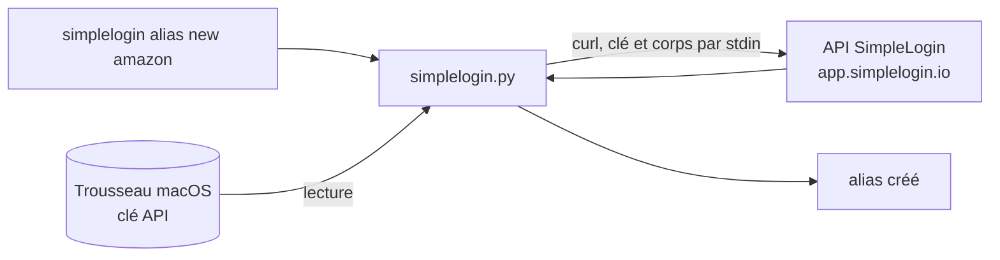

<div align="center">

[](README.en.md)


# simplelogin-cli

**Pilote ton compte SimpleLogin depuis le terminal.**<br>
Alias, mailboxes, domaines personnalisés et réglages en une commande `simplelogin`. Python et `curl`, aucune dépendance, ta clé API reste dans le Trousseau macOS.

[](LICENSE)
[](#prérequis)
[](simplelogin.py)
[](https://curl.se)
[](https://simplelogin.io)

</div>

<p align="center"></p>

## Pourquoi

Créer un alias pour chaque site, le couper quand il devient du spam, régler le catch-all d'un domaine : l'interface web de SimpleLogin sait tout faire, mais ça reste des clics. `simplelogin` met ça dans une commande, utilisable à la main, dans un script ou par un agent IA, avec des garde-fous : rien d'irréversible sans `--yes-destructive`.

La référence de l'API est le fichier [docs/api.md](https://github.com/simple-login/app/blob/master/docs/api.md) du dépôt SimpleLogin.

## Comment ça marche



- **Clé hors des arguments.** La clé API vit dans le Trousseau macOS (service `simplelogin-cli.api`). Elle passe à `curl` par stdin, jamais en argument ni en sortie, donc elle n'apparaît pas dans la liste des processus.
- **Réversible direct, destructif confirmé.** Créer, modifier, activer ou désactiver un alias s'exécute tout de suite. Supprimer un alias ou une mailbox exige `--yes-destructive`. Pour couper un alias, `alias disable` suffit.
- **Alias par adresse ou par id.** Partout où une commande attend un alias, tu peux donner l'adresse complète ou l'id numérique.

## Installation

```sh
curl -fsSL https://raw.githubusercontent.com/pyxl-dev/simplelogin-cli/main/install.sh | sh
```

L'installateur met le code dans `~/.local/share/simplelogin-cli` et rend la commande `simplelogin` disponible dans `~/.local/bin`. Relance-le pour mettre à jour ; `--uninstall` enlève tout (la config et l'entrée du Trousseau restent, il te dit comment les supprimer). Il ne touche qu'à ton dossier perso.

Ensuite :

1. Dans SimpleLogin : Settings, puis API Keys. Crée une clé.
2. `simplelogin configure`, puis colle la clé dans le champ masqué. L'URL par défaut est `https://app.simplelogin.io` ; change-la si tu utilises une instance auto-hébergée.
3. `simplelogin whoami` vérifie l'accès.

### Laisse ton agent IA s'en occuper

Colle ceci dans Claude Code, Codex, Cursor ou n'importe quel agent qui a accès à un terminal :

```text
Installe et utilise simplelogin-cli : https://github.com/pyxl-dev/simplelogin-cli
Suis le fichier AGENTS.md de ce dépôt.
```

[`AGENTS.md`](AGENTS.md) explique à l'agent comment l'installer, comment s'en servir et les règles de sécurité (ne jamais demander la clé API dans le chat, pas de suppression sans ton accord). Il est en anglais, la langue que tous les agents lisent.

### Prérequis

| | Sert à |
| --- | --- |
| macOS | stocker la clé API dans le Trousseau (commande `security`) |
| Python 3.9 ou plus | lancer le script (celui de macOS convient) |
| `curl` | parler à l'API (livré avec macOS) |
| Un compte [SimpleLogin](https://simplelogin.io) et une clé API | tout le reste |
| [o2switch-cli](https://github.com/pyxl-dev/o2switch-cli), optionnel | poser les records DNS avec les commandes que `domain dns` affiche |

## Utilisation

```sh
simplelogin alias list
simplelogin alias list netflix
simplelogin alias new amazon --domain sl.example.com --note "Amazon"
simplelogin alias random --note "forum"
simplelogin alias disable amazon@sl.example.com
simplelogin alias edit amazon@sl.example.com --note "Amazon FR" --pin
simplelogin alias activity amazon@sl.example.com
simplelogin alias reply amazon@sl.example.com contact@example.org   # adresse pour écrire depuis l'alias
simplelogin alias delete amazon@sl.example.com --yes-destructive

simplelogin mailbox list
simplelogin mailbox add me@example.com

simplelogin domain list
simplelogin domain set sl.example.com --catch-all on
simplelogin domain dns sl.example.com --verification "sl-verification=..."

simplelogin setting show
simplelogin export > alias.csv
```

`simplelogin --help` et `simplelogin <commande> --help` listent toutes les options. En plus de l'exemple ci-dessus : `alias show`, `alias contacts`, `alias list --enabled|--disabled|--pinned|--json`, `mailbox default`, `mailbox delete`, `domain trash`, `setting set clé=valeur`.

Supprimer une mailbox sans `--transfer-to` supprime aussi ses alias : le message d'erreur le rappelle avant d'exiger `--yes-destructive`.

### Domaine personnalisé

L'API ne permet pas d'ajouter un domaine : il faut le faire une fois dans l'interface web, qui affiche le code `sl-verification`. Ensuite, `simplelogin domain dns <domaine>` affiche les records à poser (MX, SPF, DKIM, DMARC, vérification). Ils sortent par défaut sous forme de commandes `o2switch dns set` (voir [o2switch-cli](https://github.com/pyxl-dev/o2switch-cli)). Pour un autre hébergeur DNS, `--format table` donne un tableau nom, type, valeur séparés par des tabulations ; pour en faire le défaut, pose `SIMPLELOGIN_DNS_FORMAT=table`.

La commande n'écrit rien dans le DNS, elle affiche seulement. Pour un domaine racine déjà utilisé par une autre messagerie, le MX et le SPF doivent être fusionnés à la main.

## Sécurité

- La clé API n'est écrite ni dans un fichier ni dans les arguments d'un processus : Trousseau macOS, puis stdin de `curl`.
- La config (`~/Library/Application Support/simplelogin-cli/config.json`) ne contient que l'URL de l'instance, en droits 600.
- `curl` n'accepte que `https` et ne suit aucune redirection.
- Aucune suppression sans `--yes-destructive`.

## Développement

```sh
git clone https://github.com/pyxl-dev/simplelogin-cli && cd simplelogin-cli
./install.sh                                  # installe ce clone
python3 -m unittest discover -s tests -v      # sans réseau ni clé
```

| Fichier | |
| --- | --- |
| `simplelogin.py` | le client API et la commande (un seul fichier, sans dépendance) |
| `tests/test_simplelogin.py` | tests avec un faux client, sans réseau |
| `install.sh` | installateur |
| `AGENTS.md` | instructions pour n'importe quel agent IA |
| `docs/` | logo et bannière |

## Licence

[MIT](LICENSE)
